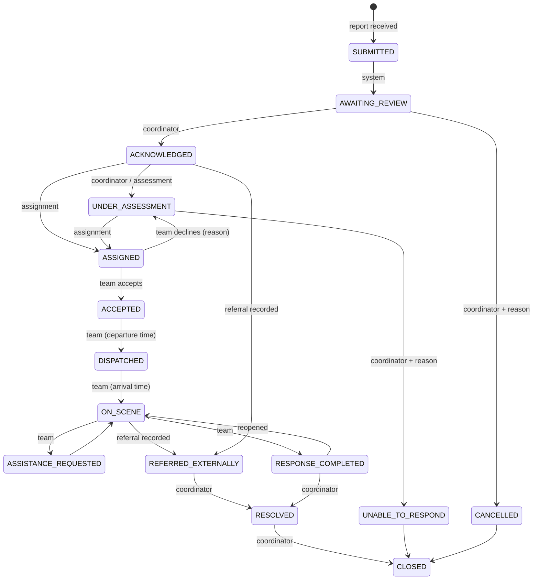
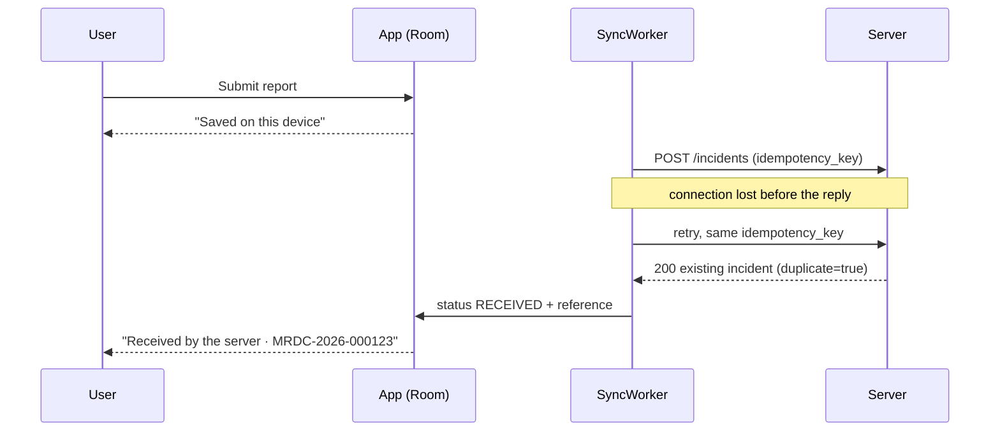
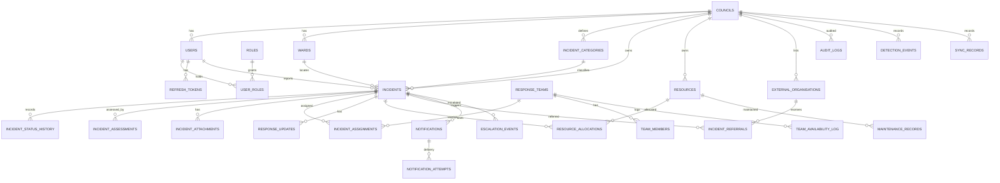

# AcciSafe RDC – Architecture

## System architecture

```mermaid
flowchart LR
  subgraph Phone["Android app (Kotlin, Compose, MVVM)"]
    UI[Compose screens] --> VM[ViewModels]
    VM --> Repo[Repositories]
    Repo --> Room[(Room: offline queue,\nconfig cache, contacts)]
    Repo --> API[Retrofit + OkHttp\nauth + token refresh]
    WM[WorkManager SyncWorker] --> Room
    WM --> API
    Sensors[Accelerometer, gyroscope, GPS] --> Mon[MonitoringService\n+ AccidentDetector]
    Mon --> Coord[DetectionCoordinator\ncountdown]
    Coord --> Repo
    Coord --> SMSP[Phone SMS to\npersonal contacts]
  end
  API -- HTTPS JSON --> BE
  subgraph Server["Backend (FastAPI)"]
    BE[REST API /api/v1\nRBAC on every endpoint] --> WF[Workflow rules\nstate machine, priority]
    BE --> DB[(PostgreSQL / SQLite)]
    ESC[Escalation worker] --> DB
    ESC --> NOTIF[Notification service]
    BE --> NOTIF
    NOTIF --> SMSA[SMS provider adapter\nlog | http gateway]
    BE --> FILES[(Attachment storage)]
  end
```

**Two separate SMS paths.** The phone sends SMS only to the user's own confirmed personal contacts,
and only after an accident alert is confirmed. Council notifications are sent by the server through
the configured gateway. Neither path calls emergency services.

## Incident workflow (emergency)



Routine service requests use: Submitted → Under review → (Inspection required) → Assigned →
Work scheduled → In progress → Completed → Closed, or Rejected with a reason. A coordinator can
escalate an open routine request to an emergency.

The full transition table, including who may perform each transition, is in
`backend/app/workflow.py` and is unit-tested.

## Offline reporting



The original device time (`reported_at`) and the server receipt time (`received_at`) are both stored.
Acknowledgement time is measured from `received_at`.

## Database (entity relationships)



Routine infrastructure requests are stored as incidents with `kind = ROUTINE`, and they have their own
status set. Every council-owned table has a `council_id` column, so councils stay isolated.

## Security decisions

- Permissions are checked on the server for every request. The app only hides what the server would refuse anyway.
- An incident outside the user's access returns HTTP 404, not 403, so its existence is not revealed.
- Passwords are hashed with scrypt.
- Access tokens last 15 minutes. Refresh tokens are single-use, stored only as hashes, and revoked on password change or deactivation.
- Tokens on the phone are encrypted with an Android Keystore AES-GCM key. Backups are disabled.
- No secrets are kept in the app. SMS credentials exist only as server environment variables.
- Audit logs can only be appended to. No endpoint updates or deletes them.
